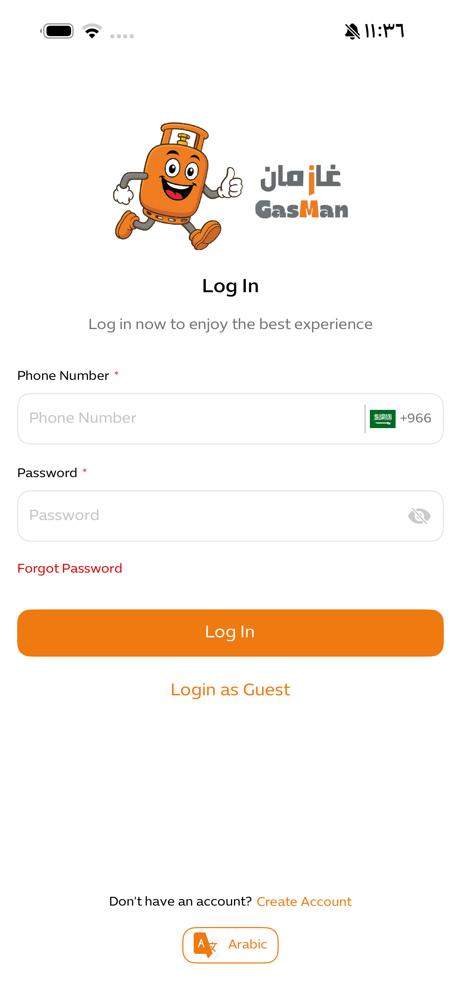
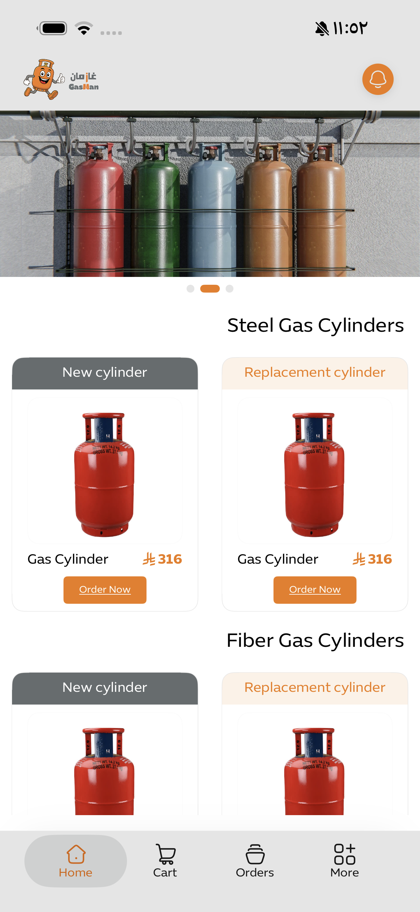
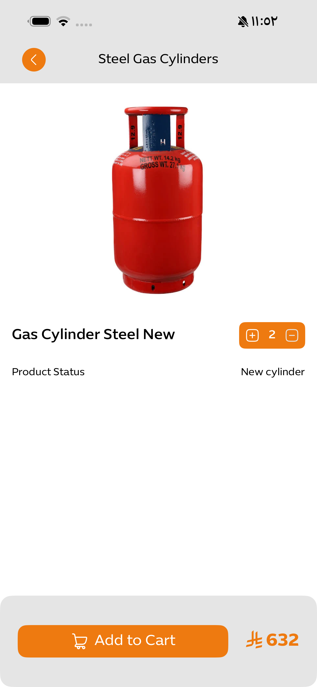
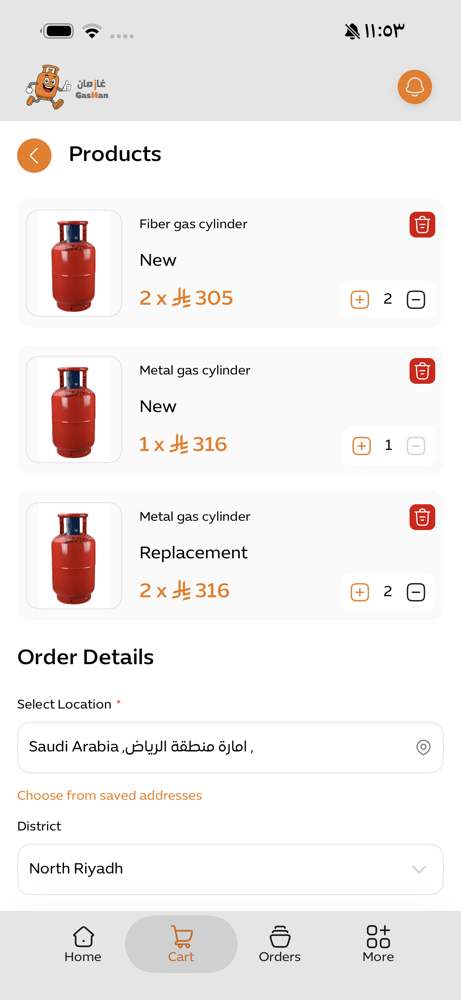
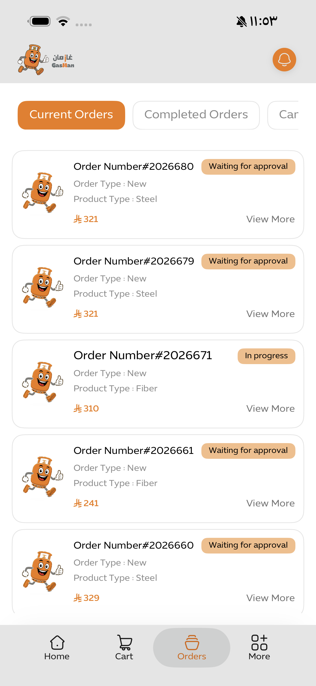
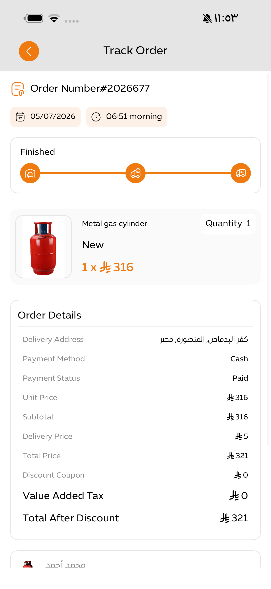
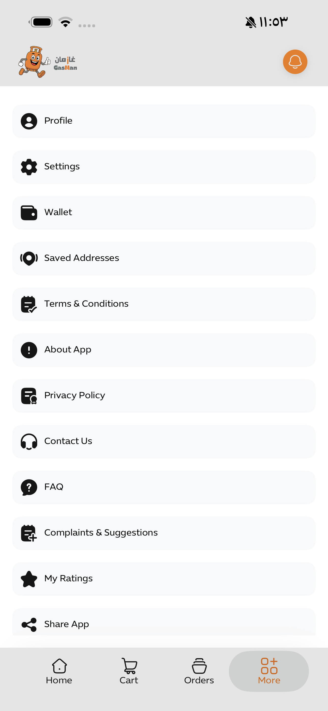

# GasMan

GasMan is an iOS app for ordering gas cylinders for home delivery. Customers can browse cylinder options, choose new or replacement cylinders, manage quantities in a cart, select a delivery address, and track their orders.

## Features

- Browse steel and fiber gas cylinders
- Choose between new and replacement cylinders
- View product details and pricing
- Add products to the cart and adjust quantities
- Select a delivery location and district
- Review current and completed orders
- Track order progress and delivery details
- Manage profile, wallet, saved addresses, and preferences
- Receive order notifications
- Arabic and English localization

## Screenshots

### Sign in and home

| Sign in | Product catalog |
|:---:|:---:|
|  |  |

### Shopping and order tracking

| Product details | Cart | Orders | Tracking |
|:---:|:---:|:---:|:---:|
|  |  |  |  |

### Account

## Tech Stack

- Swift and UIKit
- MVVM architecture
- Alamofire for networking
- Firebase services, including authentication, database, messaging, analytics, and remote configuration
- Google Maps for location features
- Socket.IO for real-time communication
- Swift Package Manager

## Run the App

1. Install Xcode on macOS.
2. Open `GasMan.xcodeproj`.
3. Allow Xcode to resolve Swift Package Manager dependencies.
4. Select the `GasMan` scheme and an iPhone simulator or development device.
5. Build and run the app.

Running the app may require project-specific Firebase, Google Maps, backend, and signing configuration. Get required configuration from the project owner, and keep private credentials out of the repository.

## Project Structure

- `GasMan/App` — customer flows, product catalog, cart, orders, and location features
- `GasMan/Core` — app and scene lifecycle
- `GasMan/Networking` — API endpoints and request/response handling
- `GasMan/Shared` — reusable views and helpers
- `GasMan/Resources` — images, fonts, colors, and animations
- `GasMan/Localization` — language support
- `GasMan/Validation` — input validation
